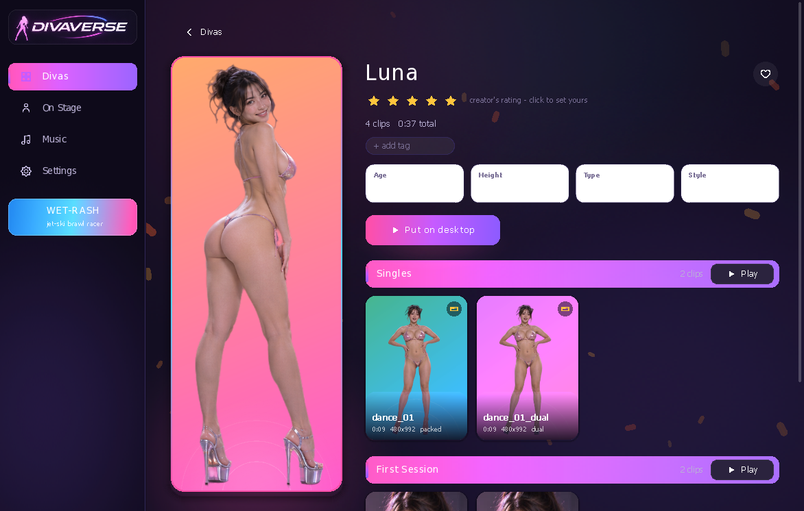
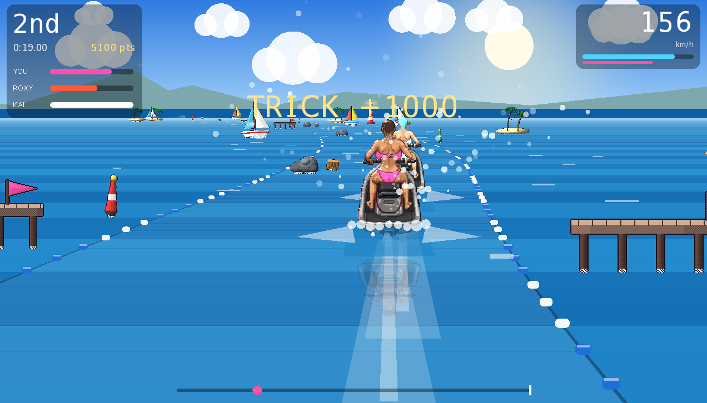
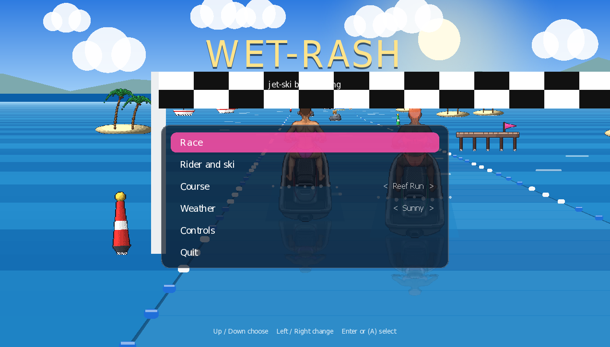
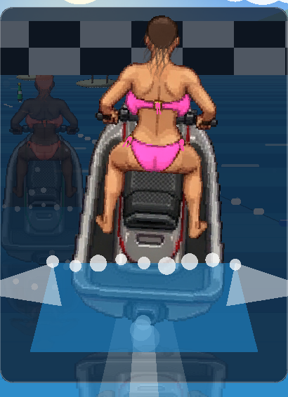
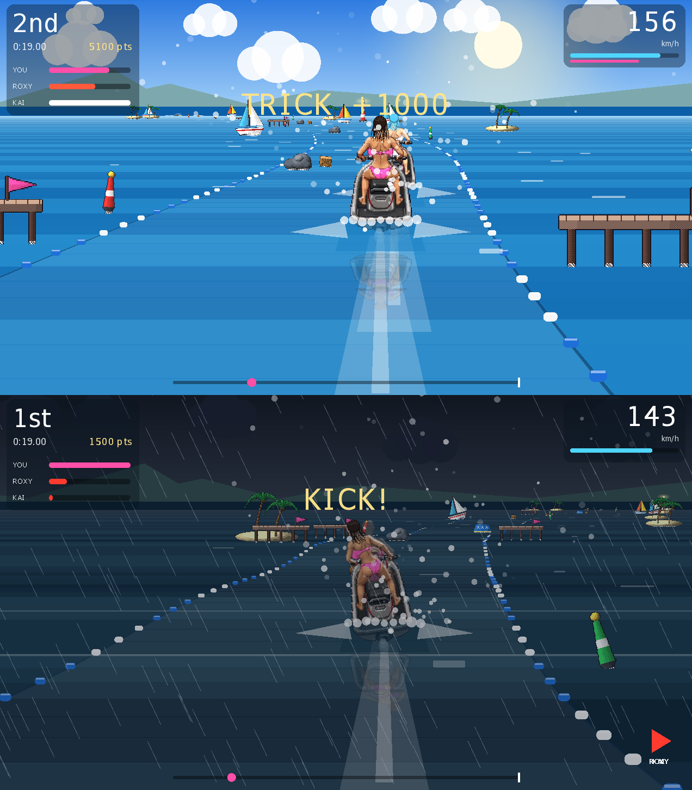

# Divaverse

A native Windows 10/11 desktop app that puts transparent-background performance clips of fictional, AI-generated
adult performers on your desktop, standing on the taskbar. One static `Divaverse.exe`, system DLLs only.

| Diva page | Wet-Rash mini game |
|---|---|
|  |  |
|  |  |



*Screenshots come from the automated Wine test harness (CPU decode, layered window). Some translucent gradients
render as solid white under Wine; on Windows they render as intended.*

## Features
- **Desktop performer**: transparent video on DirectComposition (layered-window fallback), ground-anchored on the
  taskbar, physical scale from clip metadata, click only on solid pixels, drag with optional drop back to the
  taskbar, radial quick menu, instant silent hide (Ctrl+Alt+H), playback queue, move between monitors.
- **Library**: self-contained dual-track MKV clips with embedded metadata and artwork, grouped by diva and show,
  fuzzy search, tags, ratings, favourites, recent, sort, two card sizes, tall banner art per diva, new-content reveal.
- **Music**: procedural synth stations, or your own collection (recursive import, tags, albums with art, weighted
  shuffle that learns from skips and replays, loudness levelling, M3U/PLS/WPL playlists, media keys).
- **Wet-Rash**: a jet-ski brawl racer against two bots: punches and kicks, air tricks, three courses, four
  weather types, rider/bikini/ski/hair colours, keyboard and controller, all graphics and sound generated in code
  apart from the rider and ski key frames.
- Themes (Windows, Light, Neon, Pink), seasonal decorations, synthesised interface sounds, editor mode for authored scale.

## Content
Put `.mkv` clips in `Divas\` next to the exe or add any folder in the app. The input contract is
[`Documentation/DIVAVERSE_MKV_INPUT_SPEC.md`](Documentation/DIVAVERSE_MKV_INPUT_SPEC.md); reference clips are in
`TestAssets/Divas/Luna`. A diva page banner is an MKV attachment named `banner.png` (or `banner.png` beside the clips).

## Source layout

```
Apps/Player/src/
  App.*          performer window, playback clock, watchdog + fallback chain, hotkeys, tray, settings
  Ui.cpp         launcher: Divas (library + diva page), On Stage, Music, Settings (immediate-mode widgets on Direct2D)
  Flyout.cpp     themed popup menu (tray and performer click)
  Gfx.*          Direct2D layer, palettes (Windows / Light / Neon / Pink), vector icons from path strings
  Meta.*         media probe: container facts, embedded divaverse.json, sidecar merge, validation codes
  Image.*        WIC still-image decode, thumbnail cache
  Library.*      clip scan, grouping into divas, cover / thumbnail worker
  MkvDemux.*     Matroska/EBML demuxer (tracks, cues, attachments, tags), avcC/SPS/Annex B helpers
  MfDecoder.*    H.264 through the OS decoder MFT (CPU by default, D3D11 opt-in)
  VideoSource.*  decode thread, slot ring, dual-track pairing, looping, seeking, per-frame hit mask
  Renderer.*     D3D11 + DirectComposition / layered fallback; Shaders.h
  Audio.*        WASAPI output with pluggable sources;  Synth.* procedural music;  Music.* stations + own files
Tools/build      mingw_testbuild.sh (cross-build + import check), wine_selftest.sh (regression matrix under Wine)
Tools/refmkv     make_reference.sh: builds the reference clips (ffmpeg, offline)
Tools/divapack   offline clip packer (Python + ffmpeg); content production is a separate tool, not part of the Player
TestAssets       Divas/Luna (reference clips, schema 1), SHOW-000001 (legacy manifest form)
Documentation    ARCHITECTURE.md (rules, modules, what is not implemented) and DIVAVERSE_MKV_INPUT_SPEC.md (input contract); archive/ is historical
```

Build: open `Divaverse.sln` in Visual Studio 2022, Release x64. Output `Build\Release\Divaverse.exe` plus `Divas\`.
Sources are UTF-8 and pure ASCII; the project sets `/utf-8`. The mingw-w64 static build (`Tools/build/mingw_testbuild.sh`)
is what the Wine matrix runs; Wine has no DirectComposition and no D3D11 video decoder, so those two paths are only
exercised on Windows.

Content: put `.mkv` clips (see `Documentation/DIVAVERSE_MKV_INPUT_SPEC.md`) in `Divas\` next to the exe, or add any folder
from Divas / Settings. `Shows\` and legacy show folders (`manifest.json`) are still read. Settings live in
`%APPDATA%\Divaverse`, the log (`player.log`, previous run `player.prev.log`) and the thumbnail cache in `%LOCALAPPDATA%\Divaverse`.
